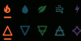
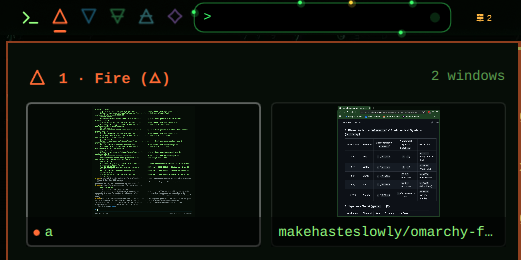

# Elemental Workspace Indicator (`elemental-workspace-indicator`)

A Hyprland workspace indicator bar widget for [Omarchy](https://omarchy.org/) that represents your workspaces with the symbols and elemental colors of the **Five Elements** across **4 selectable traditions** — plus a **resizable live floating workspace preview window** (`Small`, `Medium`, `Large`, or `Off`) on hover:

1. **Elemental Icons (`elements`)** — `󰈸 󰖌 󰌪 󰖝 󱐋` (Fire, Water, Earth, Air, Aether)
2. **Alchemical Symbols (`alchemy`)** — `🜂 🜄 🜃 🜁 ✧` (Classical Alchemical Geometry)
3. **Japanese Godai (`godai`)** — `地 水 火 風 空` (Earth, Water, Fire, Wind, Void)
4. **Chinese Wu Xing (`wuxing`)** — `木 火 土 金 水` (Wood, Fire, Earth, Metal, Water)

### Symbol Styles & Live Floating Preview

| 4 Symbol Packs (`12px` Uniform Height) | Live Floating Workspace Preview (on Hover) |
| :---: | :---: |
|  |  |

## Interactive Controls

| Action | Behavior |
| :--- | :--- |
| **Hover** any workspace icon | Opens the **Floating Workspace Preview** (`Small` / `Medium` / `Large`) showing live Wayland window thumbnails (`ScreencopyView`) and titles for that workspace |
| **Click** a window card in preview | Switches directly to that workspace and focuses that exact window |
| **Left-Click** an inactive workspace | Switches to that workspace |
| **Left-Click** the active workspace | Cycles the workspace's Hyprland layout (`dwindle` → `scrolling` → `floating`) |
| **Right-Click** any workspace icon | Cycles the symbol style and opens the **Style & Preview Size** (`Off` / `S` / `M` / `L`) popup |
| **Scroll Wheel** over widget | Scrolls through workspaces on the current monitor |

## Element & Color Maps

### 1. Elemental Icons (`elements`)

| Workspace | Element | Symbol | Codepoint | Hex Color |
| :---: | :--- | :---: | :---: | :--- |
| **1** *(6)* | **Fire** | `󰈸` | `U+F0238` | `#FF6B35` (Fiery Orange-Red) |
| **2** *(7)* | **Water** | `󰖌` | `U+F058C` | `#38BDF8` (Water Blue) |
| **3** *(8)* | **Earth** | `󰌪` | `U+F032A` | `#4ADE80` (Leaf Green) |
| **4** *(9)* | **Air** | `󰖝` | `U+F059D` | `#67E8F9` (Wind Cyan) |
| **5** *(10)* | **Aether** | `󱐋` | `U+F140B` | `#C084FC` (Aether Purple) |

### 2. Alchemical Symbols (`alchemy`)

| Workspace | Element | Symbol | Geometry | Hex Color |
| :---: | :--- | :---: | :--- | :--- |
| **1** *(6)* | **Fire** | `🜂` | `△` (Upward triangle) | `#FF6B35` (Fiery Orange-Red) |
| **2** *(7)* | **Water** | `🜄` | `▽` (Downward triangle) | `#38BDF8` (Water Blue) |
| **3** *(8)* | **Earth** | `🜃` | `▽` + crossbar | `#4ADE80` (Leaf Green) |
| **4** *(9)* | **Air** | `🜁` | `△` + crossbar | `#67E8F9` (Wind Cyan) |
| **5** *(10)* | **Aether** | `✧` | Quintessence star | `#C084FC` (Aether Purple) |

### 3. Japanese Godai (`godai`, 五代)

| Workspace | Element | Kanji | Reading | Hex Color |
| :---: | :--- | :---: | :--- | :--- |
| **1** *(6)* | **Earth** | `地` | *Chi* | `#4ADE80` (Earth Green) |
| **2** *(7)* | **Water** | `水` | *Sui* | `#38BDF8` (Water Blue) |
| **3** *(8)* | **Fire** | `火` | *Ka* | `#FF6B35` (Fire Red-Orange) |
| **4** *(9)* | **Wind** | `風` | *Fū* | `#67E8F9` (Wind Cyan) |
| **5** *(10)* | **Void** | `空` | *Kū* | `#C084FC` (Void Purple) |

### 4. Chinese Wu Xing (`wuxing`, 五行)

| Workspace | Element | Hanzi | Pinyin | Hex Color |
| :---: | :--- | :---: | :--- | :--- |
| **1** *(6)* | **Wood** | `木` | *Mù* | `#4ADE80` (Wood Green) |
| **2** *(7)* | **Fire** | `火` | *Huǒ* | `#FF6B35` (Fire Red-Orange) |
| **3** *(8)* | **Earth** | `土` | *Tǔ* | `#FBBF24` (Earth Gold) |
| **4** *(9)* | **Metal** | `金` | *Jīn* | `#E2E8F0` (Metallic Silver) |
| **5** *(10)* | **Water** | `水` | *Shuǐ* | `#38BDF8` (Water Blue) |

## Features

- **4 Selectable Symbol Packs (Uniform `12px` Optical Height):** All 4 packs (`elements`, `alchemy`, `godai`, `wuxing`) are optically calibrated to an identical `12px` height and shared vertical centerline.
- **Notification & Urgent Workspace Blinking:** When an app or browser tab (such as Google Messages in Brave, Slack, Discord, etc.) on an inactive workspace triggers a notification or Wayland urgency signal, that workspace's elemental icon pulses in brightness and scale with a glowing corner indicator dot until you switch to that workspace.
- **Resizable Live Floating Workspace Preview (on Hover):** Hovering over any workspace indicator opens a floating preview card accented in that element's color, showing live Wayland window thumbnails (`ScreencopyView`), a 360° active-window elemental border, and window titles. Click any window card in the preview to jump directly to that window, or choose your preferred preview size (`Off`, `Small`, `Medium`, `Large`) from the right-click menu.
- **Style & Preview Size Selector on Install & Right-Click:** Automatically opens a selector popup on first install when no style is stored in `shell.json`, and you can **right-click** any workspace indicator on the bar at any time to switch between the 4 styles or resize the floating preview (`Off` / `S` / `M` / `L`).
- **Focused (Active) Workspace:** Rendered at full brightness (`1.0` opacity) in its elemental color with an animated elemental underline bar.
- **Occupied Workspace:** Rendered in its elemental color at `0.78` opacity when windows are open on that workspace.
- **Empty Workspace:** Rendered in its muted elemental tint at `0.40` opacity.
- **Full Omarchy Multi-Monitor & Layout Support:** Preserves per-monitor workspace blocks (1–10 per monitor), scroll-wheel workspace switching, and left-clicking the active workspace to cycle Hyprland layouts (`dwindle` / `scrolling` / `floating`).

## Dependencies

- **Omarchy Shell** (`omarchy-shell`) and **Hyprland** (included with Omarchy).
- **Nerd Font** & **Noto Sans CJK** (included with Omarchy). No external packages or network access required.

## Installation

Install and enable directly with the `omarchy` CLI:

```bash
omarchy plugin add https://github.com/makehasteslowly/omarchy-five-elements-workspaces.git --enable
```

On first load, a popup lets you pick your preferred symbol pack. You can also switch styles or toggle the floating preview anytime by **right-clicking** the workspace indicators on the bar or running:

```bash
# Nerd Font elemental icons (󰈸 󰖌 󰌪 󰖝 󱐋)
omarchy bar set elemental-workspace-indicator style elements

# Alchemical symbols (🜂 🜄 🜃 🜁 ✧)
omarchy bar set elemental-workspace-indicator style alchemy

# Japanese Godai (地 水 火 風 空)
omarchy bar set elemental-workspace-indicator style godai

# Chinese Wu Xing (木 火 土 金 水)
omarchy bar set elemental-workspace-indicator style wuxing

# Set the floating hover preview window size (off, small, medium, large)
omarchy bar set elemental-workspace-indicator previewSize small
omarchy bar set elemental-workspace-indicator previewSize medium
omarchy bar set elemental-workspace-indicator previewSize large
omarchy bar set elemental-workspace-indicator previewSize off
```

To move the widget next to your launcher in the left bar section:

```bash
omarchy bar move elemental-workspace-indicator --section left
```

## Uninstall

```bash
omarchy plugin remove elemental-workspace-indicator
```

## License

[MIT](LICENSE)
